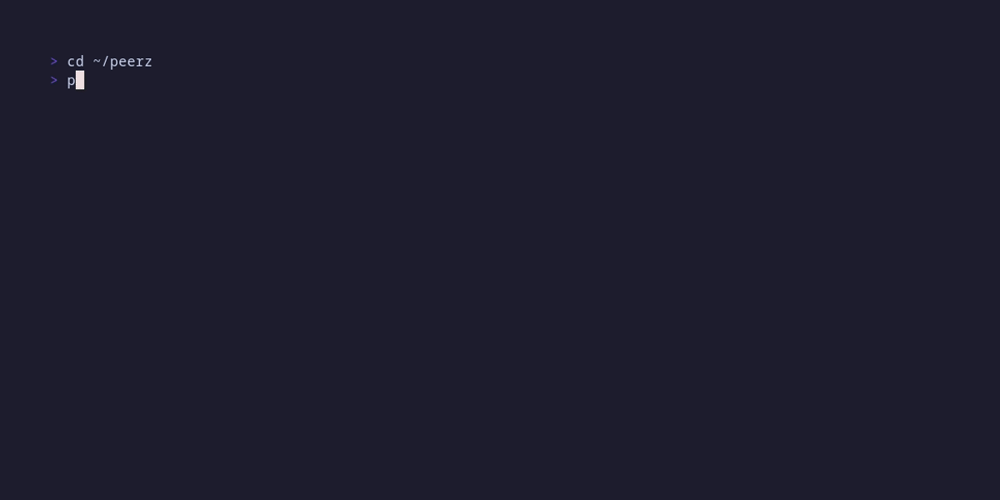

# peerz

A TUI BitTorrent client, written in Go.

> peerz can download public torrents end to end, but it's young.
> It does not support DHT, PEX or magnet links for now.

## Install

Download the binary for your system from the
[Releases page](https://github.com/tosterabgx/peerz/releases).

> btw, you can test it on torrents from testdata folder!
